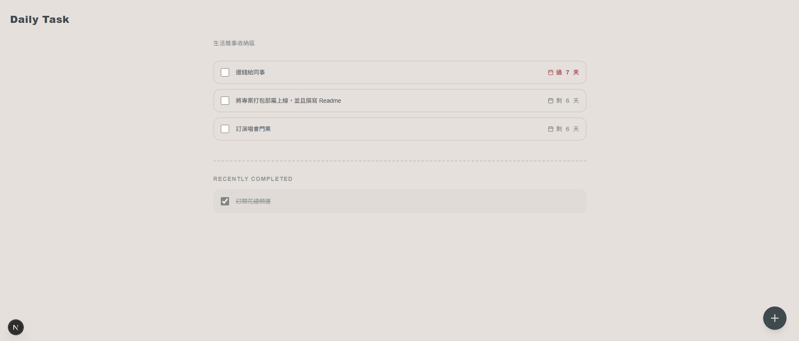
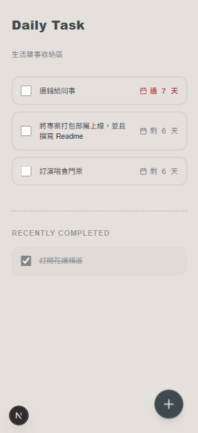
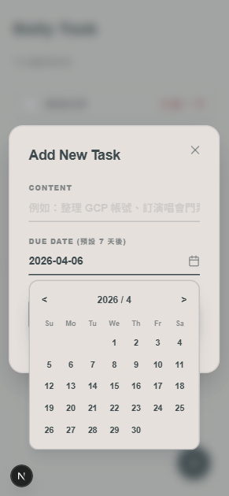

# Todo List

**繁體中文** | [English](README.en.md)

一頁式的待辦清單，給想花幾秒記下一件雜事、順便看看什麼快到期的人。把一個元件放進你的 Next.js app，就有一份適合手機使用、會倒數每個期限的清單。



- **快速新增**：圓形 **+** 按鈕會打開一個只有事項和期限兩個欄位的表單，期限預設為今天起算 7 天後。
- **期限倒數**：每個事項顯示「剩 N 天」、「今天到期」或「已過期 N 天」，而不是直接顯示日期。
- **可以反悔**：勾選完成的事項會在 Recently Completed 底下保留 24 小時，這段時間內取消勾選就會回到清單。
- **不卡頓**：勾選事項時先更新畫面，再在背景存到 Supabase；儲存失敗就重新載入清單。

<p>
  
  
</p>

介面文字是繁體中文（例如「剩 6 天」）；想改的話，編輯 `TodoApp.jsx` 裡的字串。

## 它怎麼運作

```
瀏覽器 (TodoApp.jsx) ──► Supabase client ──► 你 Supabase 專案裡的 "Todo" 資料表
```

沒有伺服器程式碼，也沒有其他服務：元件直接和你的 Supabase 專案溝通。

## 安裝

需要：一個使用 App Router、裝了 Tailwind CSS 的 Next.js app，以及一個 Supabase 專案。

1. 安裝相依套件：`npm install @supabase/supabase-js sonner lucide-react`
2. 把 `TodoApp.jsx` 複製進你的 app，在某個頁面渲染它，例如在 `app/todo/page.js` 寫 `import TodoApp from './TodoApp'`。
3. 建立 `lib/supabase.js` 並匯出一個 `supabase` client，因為元件會 import `@/lib/supabase`。把專案網址和 anon key 放進 `.env.local`。
4. 在 root layout 加上 sonner 的 `<Toaster />`，錯誤和成功訊息才會顯示。
5. 在 Supabase 打開 **SQL Editor**，執行：

```sql
CREATE TABLE "Todo" (
  id UUID DEFAULT uuid_generate_v4() PRIMARY KEY,
  content TEXT NOT NULL,
  due_date DATE,
  is_completed BOOLEAN DEFAULT FALSE,
  completed_at TIMESTAMPTZ,
  created_at TIMESTAMPTZ DEFAULT NOW()
);

-- Speeds up the query for open tasks
CREATE INDEX idx_todo_active ON "Todo"(is_completed) WHERE is_completed = FALSE;
```

6. 在 **Authentication → Policies** 為 `Todo` 資料表加上 policy，依你的情況決定誰可以讀寫。元件使用公開的 anon key，沒有登入功能。

## 隱私與安全

事項內容和日期只會從瀏覽器送到你自己的 Supabase 專案，不會送到其他地方。元件沒有任何分析追蹤。因為它使用公開的 anon key，任何拿得到這把 key 的人都能做你的資料表 policy 允許的任何事，所以公開部署前要先設好 policy。

## 授權

[MIT](LICENSE)
